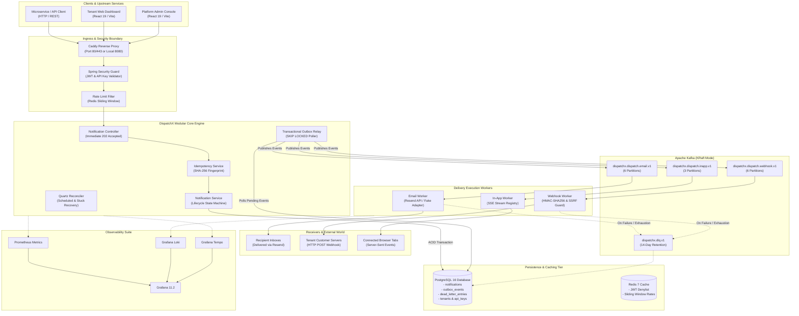
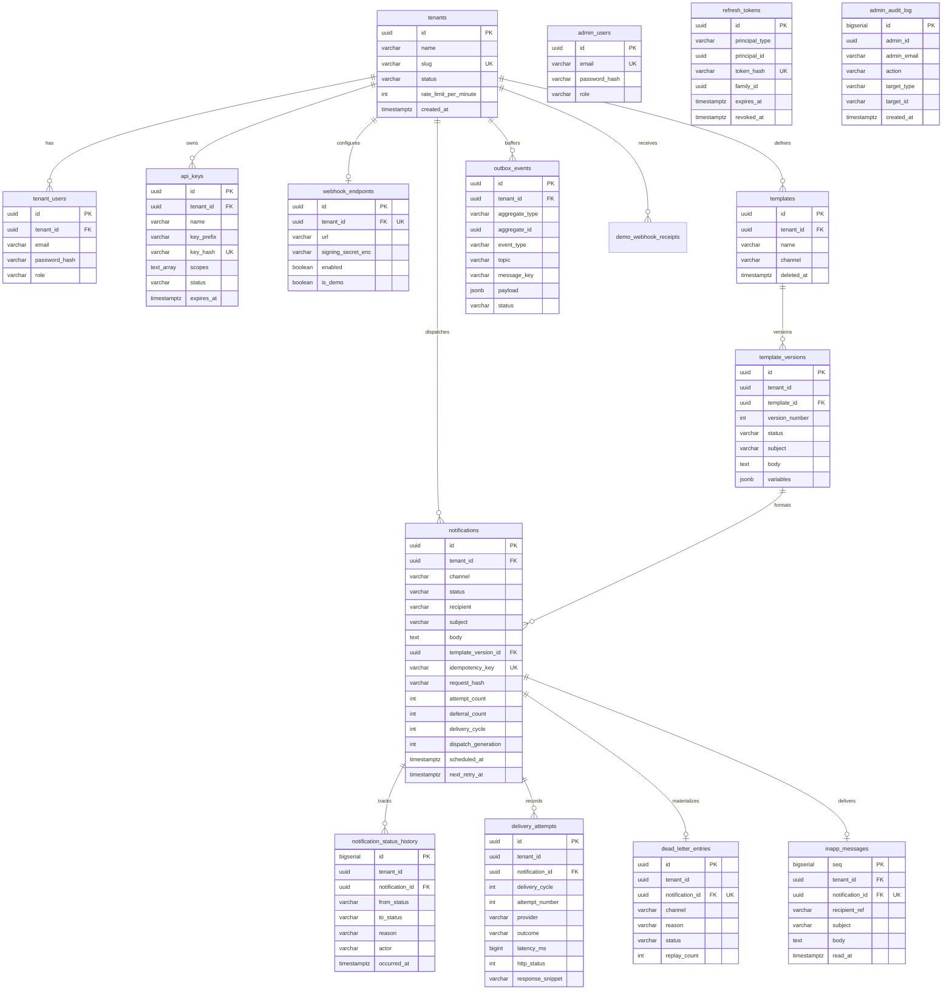
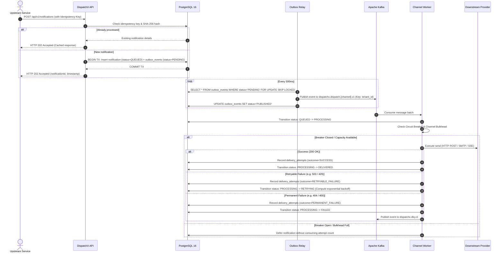

# ⚡ DispatchX

### High-Throughput, Multi-Tenant Distributed Notification Infrastructure

**Transactional outbox • Cryptographic idempotency • Partitioned Kafka event stream • End-to-end observable**

[](https://openjdk.org/projects/jdk/25/)
[](https://spring.io/projects/spring-boot)
[](https://www.postgresql.org/)
[](https://kafka.apache.org/)
[](https://redis.io/)
[](https://www.quartz-scheduler.org/)
[](https://react.dev/)
[](https://www.typescriptlang.org/)
[](https://www.docker.com/)
[](https://prometheus.io/)
[](https://grafana.com/)
[](./LICENSE)

---

## 📑 Table of Contents

- [Overview](#-overview)
- [Problem Statement](#-problem-statement)
- [Key Features](#-key-features)
- [Application Screenshots](#-application-screenshots)
- [Technology Stack](#-technology-stack)
- [System Architecture](#-system-architecture)
- [Database Design](#-database-design)
- [Project Structure](#-project-structure)
- [End-to-End Application Flow](#-end-to-end-application-flow)
- [Prerequisites](#-prerequisites)
- [Local Setup and Installation](#-local-setup-and-installation)
- [How to Run the Application Locally](#-how-to-run-the-application-locally)
- [API Documentation](#-api-documentation)
- [Configuration and Environment Variables](#-configuration-and-environment-variables)
- [Testing](#-testing)
- [Troubleshooting](#-troubleshooting)
- [Future Enhancements](#-future-enhancements)
- [Author & License](#-author--license)

---

## 🌟 Overview

**DispatchX** is an enterprise-grade, multi-tenant distributed notification delivery platform engineered for ultra-low latency ingestion and reliable, resilient asynchronous delivery across heterogeneous communication channels (**Email**, **Webhooks**, and **In-App**).

Modern web platforms (e-commerce checkout, ride-sharing booking, fintech transaction ledger) cannot afford to make synchronous network calls to third-party communication providers or remote customer endpoints during critical transaction flows. A slow SMTP handshake or a sluggish webhook receiver must never degrade core API response times or risk transaction aborts.

DispatchX solves this by decoupling notification ingestion from delivery. Upstream microservices hand off notifications via a secured REST API with immediate **HTTP 202 Accepted** responses in under **15 milliseconds**. The platform atomically persists notification state and outbox events in **PostgreSQL** using the **Transactional Outbox Pattern**, dispatches messages in strict per-tenant order across partitioned **Apache Kafka** topics, and delivers them through isolated channel workers fortified with **Circuit Breakers**, **Bulkheads**, **Token-Bucket Rate Limiters**, and **Dead-Letter Queue (DLQ) Workbenches**.

<p align="center">
  
</p>

---

## ❗ Problem Statement

Building reliable notification infrastructure in distributed microservice architectures presents four fundamental challenges:

| Challenge | Real-World Impact | How Existing Systems Fail | How DispatchX Solves It |
| :--- | :--- | :--- | :--- |
| **Ingress Latency & Coupling** | Calling external email APIs (SendGrid, Mailgun) or customer webhooks inline blocks client HTTP threads for 500ms to 5+ seconds. | Web service worker threads exhaust, cascade upstream, and increase user-perceived checkout latency. | Ingests notifications in $<15\text{ ms}$, commits to PostgreSQL with an outbox event, and answers with immediate HTTP 202. |
| **Dual-Write Inconsistency** | Saving business records to a database while pushing an event to Kafka/RabbitMQ in memory can fail midway. | Database commits but message is lost, or message publishes but database transaction rolls back (phantom notifications). | **Transactional Outbox Pattern**: Message state and outbox events commit in the exact same ACID transaction. An asynchronous relay drains events with `SKIP LOCKED`. |
| **Downstream Failures & Head-of-Line Blocking** | A customer webhook endpoint goes offline, times out, or returns 500 Internal Server Error. | Retrying failing webhooks in worker threads exhausts connection pools and blocks healthy tenants sharing the queue. | **Per-Tenant Partitioned Queues & Bulkheads**: Webhook breaker isolates failing receiver hosts; exponential backoff with jitter and non-blocking scheduling prevent thread stalls. |
| **Duplicate Delivery (Replays & Races)** | Network drops occur after downstream acceptance but before ACK receipt, causing client retries. | Customers receive duplicate payment charges, duplicate OTPs, or multiple order confirmations. | **Cryptographic Idempotency**: Strict `Idempotency-Key` tracking backed by unique database indexes and SHA-256 payload fingerprinting guarantees exactly-once business acceptance. |

---

## 🚀 Key Features

### 📨 Multi-Channel Delivery Engine
- **Email Delivery**: Integrates with modern email infrastructure (Resend API) and includes a deterministic zero-network fake adapter for local development and offline unit testing. Enforces friendly RFC 5322 display formatting (`"Tenant via DispatchX" <notifications@domain.com>`) and DKIM/SPF alignment.
- **Server-to-Server Webhooks**: Outbound HTTP POST dispatch protected by cryptographic **HMAC-SHA256 signatures** (`X-DispatchX-Signature`), epoch replay protection (`X-DispatchX-Timestamp`), strict SSRF IP range egress filtering, and destination hostname pinning.
- **Real-Time In-App Alerts**: Persistent in-app notifications exposed through **Server-Sent Events (SSE)** with monotonic sequence resumption (`Last-Event-ID`), multi-tab sync, and unread count badges.

### 🛡️ Enterprise Resiliency & Fault Tolerance
- **Transactional Outbox Relay**: Polls pending events using PostgreSQL `SELECT ... FOR UPDATE SKIP LOCKED` and publishes to Kafka with per-tenant message keys, preserving strict FIFO per tenant without global serialisation bottlenecks.
- **Resilience4j Integration**: Channel bulkheads bound concurrent provider connections; per-host circuit breakers trip open on repeated destination outages; token-bucket limiters protect upstream API limits.
- **Clustered Scheduling (Quartz)**: Clustered PostgreSQL-backed Quartz job store coordinates near-due reconciliation sweeps and scheduled notification releases across active application instances.
- **Stuck Processing Reaper**: Recovers notifications abandoned in `PROCESSING` status by crashed worker nodes using monotonic generation fencing.

### 💀 Two-Tier Dead Letter Queue (DLQ) & Quarantine Workbench
- **Business DLQ (`dispatchx.dlq.v1`)**: Materializes permanently failed or exhausted notification records into an operator workbench for auditing, root-cause triage, one-click replay, or discarding.
- **Dead Letter Topic (DLT) Quarantine**: Intercepts unparseable poison messages or broken Kafka records directly from `*.DLT` topics into an immutable quarantine store for forensics without polluting business metrics.

### 🏢 Multi-Tenant Security & Governance
- **Dual Authentication**: Scoped HS256 JWT access tokens for tenant dashboard users (`aud=dispatchx-tenant`) and platform operators (`aud=dispatchx-admin`).
- **Cryptographic API Keys**: SHA-256 hashed API keys (`dx_live_...`) with instant revocation, permission scopes, and 24-hour key rotation grace periods.
- **Tenant Lifecycle Governance**: One-click tenant suspension or revocation with immediate API key invalidation, queue drain halt, and comprehensive audit trail logging.

### 📊 End-to-End Distributed Observability
- **Prometheus Metrics**: High-cardinality bounded metric catalog (`dispatchx_notifications_created_total`, `dispatchx_delivery_attempts_total`, `dispatchx_queue_depth`, `dispatchx_outbox_pending`, `dispatchx_resilience_circuitbreaker_state`).
- **Structured Logs (Loki via Alloy)**: ECS-formatted JSON application logs enriched with MDC context (`tenantId`, `channel`, `notificationId`, `traceId`).
- **Distributed Tracing (Tempo via OTLP)**: W3C distributed tracing context propagated across HTTP ingress, database outbox, Kafka headers, and downstream channel adapters.

---

## 📸 Application Screenshots

### 1. Ingestion & Architecture Overview
The platform architecture flow and live hero interface demonstrating real-time ingestion, outbox transaction boundaries, and multi-channel routing.

| System Architecture Flow | Platform Hero Interface |
| :---: | :---: |
|  |  |

### 2. Multi-Channel Delivery Proof
Real-time delivery verification across Email (Resend DKIM/SPF), Webhook (HMAC-SHA256 signature verification), and In-App (SSE client).

| Email Delivery Verification | Webhook Signature Verification | In-App Real-Time Feed |
| :---: | :---: | :---: |
|  |  |  |

### 3. Tenant Management Console
Tenants can inspect notification lifecycle timelines, manage reusable Mustache templates, provision API keys, and test live webhooks.

| Live Demo Inbox | Tenant Dashboard & Analytics |
| :---: | :---: |
|  |  |

| Notifications Explorer & Timeline | Dynamic Template Designer | API Key Lifecycle & Rotation |
| :---: | :---: | :---: |
|  |  |  |

### 4. Platform Administration & DLQ Workbench
Platform operators monitor tenant health, review circuit breaker states, audit logs, and replay or discard dead-lettered notifications.

| Operator Overview & Status | System Health & Breakers | DLQ Replay Workbench |
| :---: | :---: | :---: |
|  |  |  |

### 5. Grafana Observability Suite & k6 Benchmark
Full-stack production telemetry powered by Prometheus, Loki, Tempo, and OpenTelemetry.

| Operations Overview Dashboard | Delivery Latency & Percentiles |
| :---: | :---: |
|  |  |

| System Health & Rate Limits | Kafka Transport & Queue Depths |
| :---: | :---: |
|  |  |

| Loki Structured ECS Logs | Tempo Distributed Trace Waterfall |
| :---: | :---: |
|  |  |

| Admin Telemetry Console | k6 Ingress Load Benchmark |
| :---: | :---: |
|  |  |

---

## 💻 Technology Stack

| Layer | Technology | Version | Purpose & Architectural Justification |
| :--- | :--- | :--- | :--- |
| **Backend Core** | **Java** | `25 LTS` | Modern Java utilizing Virtual Threads (`Loom`) for high-concurrency non-blocking I/O and pattern matching. |
| **Framework** | **Spring Boot** | `4.0.8` | Cloud-native modular monolith with Actuator, Spring Data JPA, and declarative configuration. |
| **Primary Database** | **PostgreSQL** | `16-alpine` | Relational source of truth; ACID compliance; lock-free `SKIP LOCKED` concurrency; Flyway schema migrations. |
| **Distributed Broker** | **Apache Kafka** | `3.8.0` | Event-driven dispatch backbone in KRaft mode (ZooKeeper-free); per-tenant partitioned ordering; durable topic log. |
| **Caching & In-Memory**| **Redis** | `7-alpine` | Token denylist, sliding-window rate limit counters, and ephemeral distributed cache. |
| **Job Scheduling** | **Quartz Scheduler**| `2.3.x` | Clustered database-backed job store coordinating scheduled notifications and reconciler sweeps. |
| **Fault Tolerance** | **Resilience4j** | `2.3.0` | Programmatic circuit breakers, channel bulkheads, and token-bucket rate limiters guarding downstream outbound calls. |
| **Frontend UI** | **React** | `19.0.0` | Modern component architecture, React Router v7, Lucide React icons, and unified CSS token design system. |
| **Language & Build** | **TypeScript** | `5.7.2` | Strict compile-time type safety across API clients, DTOs, and UI state models. |
| **Bundler & Tooling** | **Vite** | `6.4.5` | Lightning-fast HMR development server and production Rollup build pipeline. |
| **Reverse Proxy** | **Caddy** | `2-alpine` | Production ingress reverse proxy with automated TLS, security headers, and reverse proxy routing. |
| **Metrics & Telemetry**| **Prometheus** | `v2.54.1` | Time-series scraper collecting custom `dispatchx_*` application meters and system metrics. |
| **Dashboards** | **Grafana** | `11.2.0` | Unified pane of glass with pre-provisioned dashboards for Delivery, System, Overview, and Transport. |
| **Structured Logging** | **Grafana Loki** | `3.1.1` | High-efficiency log aggregation consuming ECS-formatted JSON logs forwarded by Grafana Alloy. |
| **Distributed Tracing**| **Grafana Tempo** | `2.6.0` | High-scale distributed tracing backend ingesting OpenTelemetry spans via OTLP gRPC/HTTP. |

---

## 🏛️ System Architecture

DispatchX is engineered as a **Modular Monolith with Event-Driven Delivery Workers**. The architecture cleanly separates API ingestion, database persistence, asynchronous dispatch, and channel delivery:



### Component Breakdown
1. **Ingress & Security Boundary**: Validates incoming bearer JWTs or `X-API-Key` headers. Rejects revoked credentials and applies per-tenant rate limits using Redis.
2. **Idempotency Guard**: Intercepts requests carrying an `Idempotency-Key`. Computes a canonical SHA-256 hash of the payload. If an identical request was already accepted, returns the cached 202 response immediately without re-dispatching.
3. **Core Ingestion Engine**: Validates recipient targets and renders template variables. Inserts notification row in `CREATED`/`QUEUED` status and simultaneously writes a pending event into `outbox_events` in a single ACID commit.
4. **Outbox Relay Worker**: A dedicated background daemon executes `SELECT ... FOR UPDATE SKIP LOCKED` on `outbox_events`, transforms the payload to Kafka format, and streams to the channel-specific Kafka topic keyed by `tenant_id`.
5. **Channel Delivery Workers**: Independent Kafka consumer groups pull messages, acquire channel bulkheads, check destination circuit breakers, execute the outbound send, and log delivery latencies and HTTP status codes into `delivery_attempts`.
6. **DLQ Materializer**: Consumes permanently failed messages from `dispatchx.dlq.v1`, records them into `dead_letter_entries`, and exposes them to the Admin UI for one-click replay or resolution.

---

## 🗄️ Database Design

DispatchX uses PostgreSQL 16 with strong typing, foreign key cascades, JSONB flexibility for metadata, and partial indexes optimized for queue sweeps:



### Table Dictionary & Primary Purpose
- **`tenants`**: Top-level organization accounts. Governs status (`ACTIVE`, `SUSPENDED`, `REVOKED`) and custom rate limits.
- **`notifications`**: Primary state machine aggregate. Contains cycle fence, generation counter, and scheduled timestamps.
- **`notification_status_history`**: Strict append-only audit trail logging every lifecycle transition (`CREATED` $\to$ `QUEUED` $\to$ `PROCESSING` $\to$ `DELIVERED`).
- **`delivery_attempts`**: Granular attempt logs recording latency, provider outcome, HTTP status, and response snippet per delivery cycle.
- **`outbox_events`**: Transactional outbox table maintaining zero-loss event guarantees before Kafka transport.
- **`dead_letter_entries`**: Business DLQ entries holding state snapshots, failure reasons, and replay counters.
- **`webhook_endpoints`**: Stores encrypted AES-256-GCM signing secrets and target URLs.

---

## 📁 Project Structure

```text
DispatchX/
├── .github/
│   └── workflows/
│       ├── gate.yml               # Complete CI verification gate (JDK 25, Node 22, Testcontainers)
│       ├── release.yml            # Multi-arch Docker packaging & GHCR push
│       └── email-e2e.yml          # Live Resend outbound verification workflow
├── api-collection/                # Comprehensive Bruno REST API collection
│   ├── bruno.json
│   ├── environments/Local.bru
│   ├── notifications/             # Notification endpoints (Create, Get, List, Cancel)
│   └── templates/                 # Template versioning & publishing endpoints
├── assets/screenshots/            # High-resolution architectural & UI screenshots
├── docs/images/                   # Documentation image assets (matches screenshots)
├── backend/                       # Spring Boot 4 / Java 25 Modular Monolith
│   ├── pom.xml                    # Maven POM (pinned dependencies & test configurations)
│   ├── mvnw / mvnw.cmd            # Maven wrapper binaries
│   └── src/
│       ├── main/
│       │   ├── java/com/dispatchx/
│       │   │   ├── DispatchXBackendApplication.java # Spring Boot main entrypoint
│       │   │   ├── admin/         # Platform admin controllers, audit services & tenant management
│       │   │   ├── analytics/     # Aggregated usage metrics & summary reports
│       │   │   ├── apikey/        # API key generation, hashing & rotation grace logic
│       │   │   ├── auth/          # JWT tokens, refresh cookie lifecycle & bcrypt security
│       │   │   ├── common/        # Shared models, DB routing & exception handlers
│       │   │   ├── delivery/      # Workers, circuit breakers, retry calculators & adapters
│       │   │   │   ├── provider/  # Channel adapters: Email (Resend/Fake), Webhook, In-App
│       │   │   │   ├── recovery/  # Stuck processing reaper & crash recovery
│       │   │   │   ├── resilience/# Resilience4j bulkheads, rate-limiters & breaker registries
│       │   │   │   └── worker/    # Kafka listener containers per channel
│       │   │   ├── demo/          # Ephemeral webhook receiver & sandbox inbox
│       │   │   ├── dlq/           # DLQ & DLT quarantine materialization and replay engine
│       │   │   ├── idempotency/   # Cryptographic canonical payload hash calculator
│       │   │   ├── inapp/         # In-app message repository & unread state management
│       │   │   ├── kafka/         # Programmatic topic initialization & producer configuration
│       │   │   ├── notification/  # Notification aggregate, state machine & repository
│       │   │   ├── observability/ # Custom Micrometer meters & Prometheus scrape binders
│       │   │   ├── outbox/        # Lock-free SKIP LOCKED relay daemon
│       │   │   ├── quartz/        # Clustered Quartz job store & reconciler service
│       │   │   ├── ratelimit/     # Redis sliding-window token bucket filter
│       │   │   ├── retention/     # Scheduled historical notification pruning
│       │   │   ├── sse/           # Server-Sent Events client registry & fanout bus
│       │   │   ├── template/      # Versioned template manager & variable engine
│       │   │   ├── tenant/        # Tenant workspace management
│       │   │   └── webhook/       # SSRF destination resolver & HMAC-SHA256 signer
│       │   └── resources/
│       │       ├── application.yml         # Core production/dev application settings
│       │       └── db/migration/           # Flyway SQL migrations (V1 to V10)
│       └── test/                          # Unit, slice & Testcontainers integration suites
├── frontend/                      # React 19 / TypeScript / Vite Single-Page Application
│   ├── package.json               # Frontend dependencies & test scripts
│   ├── vite.config.ts             # Vite proxy & build configuration
│   ├── index.html                 # Main application HTML entrypoint
│   ├── src/
│   │   ├── api/                   # Typed API clients (notifications, admin, webhooks, auth)
│   │   ├── auth/                  # Admin & Tenant React Context providers
│   │   ├── components/            # Reusable UI primitives (KpiStrip, LifecycleRail, ChartPanel)
│   │   ├── pages/                 # Tenant pages (Dashboard, Notifications, Templates, Webhooks)
│   │   ├── pages/admin/           # Operator pages (DLQ Workbench, System Health, Tenants)
│   │   └── styles/tokens.css      # SaaS design tokens, theme variables & layout primitives
│   ├── test/                      # Frontend unit tests
│   └── e2e/ & e2e-delivery/       # Playwright journeys & automated delivery tests
├── infra/                         # Production & Local Infrastructure
│   ├── docker-compose.yml         # Local stack (Postgres, Redis, Kafka, Observability)
│   ├── docker-compose.prod.yml    # Hardened production stack with Caddy reverse proxy
│   ├── grafana/                   # Pre-provisioned Grafana datasources & dashboard JSONs
│   ├── prometheus/                # Prometheus configuration & alert rules
│   ├── loki/                      # Grafana Loki storage configuration
│   ├── tempo/                     # Grafana Tempo trace configuration
│   ├── alloy/                     # Grafana Alloy collector pipeline
│   └── otel-collector/            # OpenTelemetry Collector OTLP pipeline
├── scripts/                       # Automation, Benchmarking & Reliability Verification
│   ├── gate.ps1 / gate.sh         # Complete automated verification suite
│   ├── e2e-delivery.ps1           # Disposable stack delivery test harness
│   ├── send-batch-demo.ps1        # High-volume multi-channel batch dispatcher
│   ├── test-idempotency-race.ps1  # Concurrency race verification harness
│   └── perf/                      # k6 load benchmark scripts
├── .env.example                   # Local environment variable template
├── docker-compose.yml             # Root compose delegating to infra/docker-compose.yml
├── LICENSE                        # MIT License
└── README.md                      # Primary project documentation
```

---

## 🔄 End-to-End Application Flow

The following sequence details how a message is accepted, asynchronously scheduled, safely dispatched, and monitored:



### Step-by-Step Flow Explanation
1. **API Call**: An upstream client issues `POST /api/v1/notifications` with an `Idempotency-Key` and message payload.
2. **Instant Acceptance ($<15\text{ ms}$)**: DispatchX checks idempotency, renders any associated template, and writes both the notification record and the outbox event in **one transaction**. An `HTTP 202 Accepted` response returns immediately.
3. **Outbox Polling**: The Outbox Relay executes a non-blocking `SELECT ... FOR UPDATE SKIP LOCKED` query on PostgreSQL, extracting pending events and streaming them to Kafka.
4. **Partition-Keyed Dispatch**: Events are keyed by `tenant_id`, guaranteeing per-tenant FIFO ordering without cross-tenant head-of-line blocking.
5. **Worker Execution**: The relevant channel worker consumes the record, acquires a bulkhead lease, verifies circuit breaker health, and delivers the payload to the external provider.
6. **Delivery Outcome Logging**: Attempt latency, HTTP code, and response snippet are recorded in `delivery_attempts`. Exhausted attempts move the notification to `FAILED` and emit an event to `dispatchx.dlq.v1`.

---

## 📋 Prerequisites

Before installing DispatchX, ensure the following software is installed on your workstation:

| Requirement | Minimum Version | Recommended Version | Verification Command |
| :--- | :--- | :--- | :--- |
| **Java Development Kit (JDK)** | `21+` (Required for running); `25` (Production container) | `25 LTS (Eclipse Temurin)` | `java -version` |
| **Node.js** | `20.x+` | `22.x LTS` | `node -v` |
| **npm** | `10.x+` | `10.8+` | `npm -v` |
| **Docker Desktop / Engine** | `24.0+` | `27.x+` | `docker --version` |
| **Docker Compose** | `v2.20+` | `v2.30+` | `docker compose version` |
| **Git** | `2.40+` | Latest | `git --version` |

---

## ⚙️ Local Setup and Installation

### 1. Clone the Repository
```bash
git clone https://github.com/bhargavputti/DispatchX.git
cd DispatchX
```

### 2. Configure Environment Variables
Copy the provided environment template to `.env` in the repository root:
```bash
# On Linux/macOS
cp .env.example .env

# On Windows (PowerShell)
Copy-Item .env.example .env
```

*(Optional)* If you wish to test real outbound emails, open `.env` and set:
```dotenv
DISPATCHX_EMAIL_PROVIDER=resend
DISPATCHX_RESEND_API_KEY=re_your_actual_api_key_here
DISPATCHX_MAIL_FROM=onboarding@resend.dev
```
Otherwise, leave `DISPATCHX_EMAIL_PROVIDER=fake` (default zero-network mock).

---

## 🏃 How to Run the Application Locally

You can run DispatchX either completely containerized via Docker Compose or in a hybrid developer mode (infrastructure in Docker, application running natively).

---

### Method A: Single-Command Docker Compose (Recommended)

Start the entire stack including databases, message brokers, backend monolith, frontend UI, and observability suite:

```bash
# Start core infrastructure, application services, and observability
docker compose --profile core --profile app --profile obs up -d
```

#### Service Verification Table
| Service Name | Container Name | Host URL / Port | Credentials / Purpose |
| :--- | :--- | :--- | :--- |
| **Frontend UI** | `dispatchx-frontend` | [http://localhost:5173](http://localhost:5173) | Main Web Dashboard & Demo Inbox |
| **Backend API** | `dispatchx-backend` | [http://localhost:8080](http://localhost:8080) | REST API & Actuator Health Endpoints |
| **Grafana Dashboards** | `dispatchx-grafana` | [http://localhost:3000](http://localhost:3000) | User: `admin` / Password: `admin` |
| **Prometheus** | `dispatchx-prometheus`| [http://localhost:9090](http://localhost:9090) | Time-series metrics engine |
| **PostgreSQL 16** | `dispatchx-postgres` | `localhost:5432` | DB: `dispatchx`, User: `dispatchx_user` |
| **Redis 7** | `dispatchx-redis` | `localhost:6379` | Token cache & rate limiter |
| **Apache Kafka** | `dispatchx-kafka` | `localhost:9092` | KRaft Event Broker |

To stop the containers:
```bash
docker compose --profile core --profile app --profile obs down
```

---

### Method B: Native Developer Mode (Step-by-Step)

For rapid development with hot module reloading in React and instant compilation in Java:

#### Step 1: Start Infrastructure Containers Only
From the root directory:
```bash
docker compose --profile core --profile obs up -d
```
Verify PostgreSQL, Redis, and Kafka are healthy:
```bash
docker compose ps
```

#### Step 2: Run the Backend Monolith
Open a terminal in `backend/`:
```bash
cd backend

# On Linux/macOS
./mvnw spring-boot:run

# On Windows (PowerShell)
.\mvnw.cmd spring-boot:run
```
*Expected Port: `8080`*  
*Verify Health*:
```bash
curl -s http://localhost:8080/actuator/health
# Returns: {"status":"UP","components":{"db":{"status":"UP"},...}}
```

#### Step 3: Run the Frontend Application
Open a new terminal in `frontend/`:
```bash
cd frontend

# Install dependencies
npm install

# Start Vite developer server
npm run dev
```
*Expected Port: `5173`*  
*Open in Browser*: [http://localhost:5173](http://localhost:5173)

#### Step 4: Seed Default Administrator Identity
The backend automatically seeds a platform administrator on first boot:
- **Email**: `admin@dispatchx.local`
- **Password**: `placeholder_admin_password_min_10_chars`
- **Admin Login URL**: [http://localhost:5173/admin/login](http://localhost:5173/admin/login)

---

## 📡 API Documentation

All tenant endpoints require either a **Bearer JWT Token** (acquired via `/auth/login`) or an **API Key** (`X-API-Key: dx_live_...`).

### 1. Ingest Notification
`POST /api/v1/notifications`

**Headers**:
```http
Content-Type: application/json
X-API-Key: dx_live_0123456789abcdef0123456789abcdef
Idempotency-Key: invoice-paid-evt-88491
```

**Request Body**:
```json
{
  "channel": "EMAIL",
  "recipient": "alex.chen@enterprise.io",
  "subject": "Invoice #88491 Payment Confirmed",
  "body": "Hi Alex, we received your payment of $450.00.",
  "metadata": {
    "invoiceId": "INV-88491",
    "tier": "enterprise"
  }
}
```

**Response (`202 Accepted`)**:
```json
{
  "id": "e6f9d784-18c2-4cf3-9f89-8d59850e3fa0",
  "status": "QUEUED",
  "channel": "EMAIL",
  "recipient": "alex.chen@enterprise.io",
  "idempotencyKey": "invoice-paid-evt-88491",
  "createdAt": "2026-11-27T18:00:00.000Z",
  "scheduledFor": null
}
```

---

### 2. Retrieve Notification Lifecycle & Attempts
`GET /api/v1/notifications/{id}`

**Response (`200 OK`)**:
```json
{
  "id": "e6f9d784-18c2-4cf3-9f89-8d59850e3fa0",
  "status": "DELIVERED",
  "channel": "EMAIL",
  "recipient": "alex.chen@enterprise.io",
  "subject": "Invoice #88491 Payment Confirmed",
  "attemptCount": 1,
  "createdAt": "2026-11-27T18:00:00.000Z",
  "attempts": [
    {
      "attemptNumber": 1,
      "provider": "resend",
      "outcome": "SUCCESS",
      "httpStatus": 200,
      "latencyMs": 284,
      "finishedAt": "2026-11-27T18:00:00.312Z"
    }
  ]
}
```

---

### 3. Real-Time In-App Event Stream
`GET /api/v1/inapp/stream`

**Headers**:
```http
Accept: text/event-stream
Authorization: Bearer <jwt_token>
Last-Event-ID: 42
```

**Stream Event Sample**:
```http
event: notification
id: 43
data: {"id":"e6f9d784-18c2-4cf3-9f89-8d59850e3fa0","subject":"Security Alert","body":"New login from Chrome/macOS","createdAt":"2026-11-27T18:02:10.123Z"}
```

---

### 4. Overview of Key API Endpoints

| Category | Method | Endpoint Path | Auth Required | Description |
| :--- | :--- | :--- | :--- | :--- |
| **Notifications** | `POST` | `/api/v1/notifications` | API Key / JWT | Accepts a notification for durable asynchronous delivery. |
| **Notifications** | `GET` | `/api/v1/notifications` | API Key / JWT | Lists notifications with status, channel, and pagination filters. |
| **Notifications** | `GET` | `/api/v1/notifications/{id}` | API Key / JWT | Retrieves notification details, attempt history, and timeline. |
| **Notifications** | `POST` | `/api/v1/notifications/{id}/cancel` | API Key / JWT | Cancels a scheduled or queued notification. |
| **Templates** | `POST` | `/api/v1/templates` | JWT | Creates a reusable template with subject and body definitions. |
| **Templates** | `POST` | `/api/v1/templates/{id}/versions/{v}/publish`| JWT | Publishes a template draft version to active status. |
| **Webhooks** | `PUT` | `/api/v1/webhook-endpoints` | JWT | Configures tenant webhook URL & provisions AES-256 secret. |
| **Webhooks** | `POST` | `/api/v1/webhook-endpoints/test` | JWT | Triggers a signed test ping webhook. |
| **API Keys** | `POST` | `/api/v1/api-keys` | JWT | Generates a new cryptographic API key with specific scopes. |
| **Admin Operations**| `GET` | `/api/v1/admin/tenants` | Admin JWT | Lists all registered tenants and statuses. |
| **Admin Operations**| `POST` | `/api/v1/admin/dlq/{id}/replay` | Admin JWT | Re-queues a dead-lettered message for fresh delivery. |
| **Admin Operations**| `GET` | `/api/v1/admin/system/status` | Admin JWT | Evaluates circuit breaker states and infrastructure health. |

---

## 🔒 Configuration and Environment Variables

The table below lists all primary environment variables configured in [.env.example](file:///c:/Users/sunny/OneDrive/Documents/Notify/.env.example):

| Variable | Default Value | Description |
| :--- | :--- | :--- |
| `DISPATCHX_ROLE` | `all` | Monolith runtime role: `all` (full engine), `api` (ingress only), `worker` (consumers only). |
| `DISPATCHX_PUBLIC_URL` | `http://localhost:8080` | Canonical public backend URL for callbacks and link generation. |
| `DISPATCHX_FRONTEND_URL` | `http://localhost:5173` | CORS allowed origin for tenant dashboard. |
| `POSTGRES_DB` | `dispatchx` | PostgreSQL database name. |
| `POSTGRES_USER` | `dispatchx_user` | PostgreSQL database user. |
| `POSTGRES_PASSWORD` | `placeholder_db_password` | PostgreSQL database password (must be rotated in production). |
| `SPRING_DATASOURCE_URL`| `jdbc:postgresql://localhost:5432/dispatchx` | JDBC connection string. |
| `SPRING_DATA_REDIS_HOST`| `localhost` | Redis server hostname. |
| `SPRING_DATA_REDIS_PORT`| `6379` | Redis server port. |
| `SPRING_KAFKA_BOOTSTRAP_SERVERS` | `localhost:9092` | Kafka broker bootstrap list. |
| `DISPATCHX_JWT_SECRET` | `placeholder_hs256_secret_key_...` | 256-bit secret key for HS256 JWT access token validation. |
| `DISPATCHX_ADMIN_EMAIL` | `admin@dispatchx.local` | Initial operator account seeded on startup. |
| `DISPATCHX_ADMIN_PASSWORD` | `placeholder_admin_password_min_10_chars` | Initial operator account password. |
| `DISPATCHX_EMAIL_PROVIDER`| `fake` | Outbound email engine: `fake` (in-memory mock) or `resend` (live network). |
| `DISPATCHX_RESEND_API_KEY`| *(Empty)* | Resend API key (`re_...`). |
| `DISPATCHX_MAIL_FROM` | `notifications@example.com` | Verified outbound sender identity. |
| `DISPATCHX_WORKER_EMAIL_ENABLED` | `true` | Enables background email Kafka consumer worker. |
| `DISPATCHX_WORKER_WEBHOOK_ENABLED` | `true` | Enables background webhook Kafka consumer worker. |
| `DISPATCHX_WORKER_INAPP_ENABLED` | `true` | Enables background in-app SSE Kafka consumer worker. |
| `DISPATCHX_OUTBOX_RELAY_ENABLED` | `true` | Enables the transactional outbox polling daemon. |
| `DISPATCHX_RECONCILER_ENABLED` | `true` | Enables the Quartz near-due and recovery reconciler. |

---

## 🧪 Testing

DispatchX maintains rigorous test suites covering unit logic, integration boundaries with Testcontainers, and browser-driven end-to-end flows.

### 1. Backend Automated Testing
Execute the complete backend test suite (utilizes Testcontainers to automatically start real PostgreSQL and Kafka instances):
```bash
cd backend

# Run all unit and integration tests
./mvnw test

# Run tests with a specific profile
./mvnw test -Dspring.profiles.active=test
```

### 2. Frontend Unit Testing
Run native TypeScript tests in the frontend:
```bash
cd frontend

npm test
```

### 3. End-to-End Delivery Verification Harness
DispatchX includes a dedicated PowerShell script that spins up an isolated, disposable Docker environment, runs full email, webhook, and SSE acceptance journeys, and cleans up automatically:
```bash
# From repository root
powershell -ExecutionPolicy Bypass -File scripts/e2e-delivery.ps1
```

### 4. Performance & Load Benchmarking
Run high-concurrency k6 ingress benchmarking against a running local instance:
```bash
# Run advisory throughput showcase
powershell -ExecutionPolicy Bypass -File scripts/run-throughput-showcase.ps1
```

---

## 🛠️ Troubleshooting

### 1. Kafka Broker Connection Refused (`Connection to node -1 could not be established`)
- **Cause**: The backend started before Kafka KRaft completed its cluster metadata quorum, or port `9092` is not reachable.
- **Fix**: Check Kafka health using `docker compose ps kafka`. Ensure `SPRING_KAFKA_BOOTSTRAP_SERVERS` matches `localhost:9092` (when running native backend) or `kafka:29092` (inside Docker network).

### 2. Webhook Destination Rejected (`DESTINATION_REJECTED`)
- **Cause**: The webhook receiver URL resolves to an internal loopback (`127.0.0.1`, `localhost`) or private network IP (RFC 1918) without the demo allowlist enabled.
- **Fix**: In non-production environments, set `DISPATCHX_WEBHOOK_DEMO_ALLOWLIST=127.0.0.1,localhost` in your `.env` to permit local webhook debugging.

### 3. Email Send Skipped with Fake Provider
- **Cause**: `DISPATCHX_EMAIL_PROVIDER` is set to `fake`.
- **Fix**: The fake provider writes deliveries to logs and reports success without contacting any external network. To send real emails, obtain a free API key from [Resend](https://resend.com) and configure `DISPATCHX_EMAIL_PROVIDER=resend`.

### 4. Java Compiler Version Mismatch (`release version 25 not supported`)
- **Cause**: The local workstation has JDK 21 or earlier installed, while `pom.xml` targets Java 25.
- **Fix**: Run the backend via Docker Compose (`docker compose up dispatchx-backend`), or install JDK 25 LTS (Eclipse Temurin) on your development machine.

---

## 🔮 Future Enhancements

- 📱 **SMS Channel Adapter**: Direct integration with Twilio and AWS SNS for SMS dispatch with regional compliance formatting.
- 🔔 **Mobile Push Notifications**: Native support for Firebase Cloud Messaging (FCM) and Apple Push Notification service (APNs).
- 📦 **Webhook Batch Bundling**: Aggregate multiple tenant notifications destined for the same endpoint into a single batched HTTP POST payload.
- 🌐 **Geo-Distributed Kafka Clusters**: Multi-region Kafka replication with regional outbox routing for sub-5ms global acceptance.

---

## 👤 Author & License

**DispatchX** was designed and engineered by:

**Bhargav Putti**  
- **GitHub**: [@bhargavputti](https://github.com/bhargavputti)  
- **Email**: [bhargavaputti@gmail.com](mailto:bhargavaputti@gmail.com)  

### License
This project is licensed under the **MIT License** — see the [LICENSE](./LICENSE) file for complete details.

---

<div align="center">
  <sub>Built with Java 25, Spring Boot 4, Apache Kafka, PostgreSQL, Redis, and React 19. Engineered for resilience.</sub>
</div>
